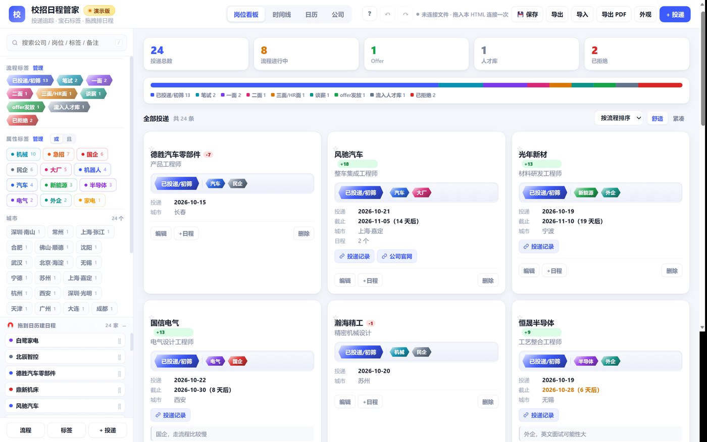
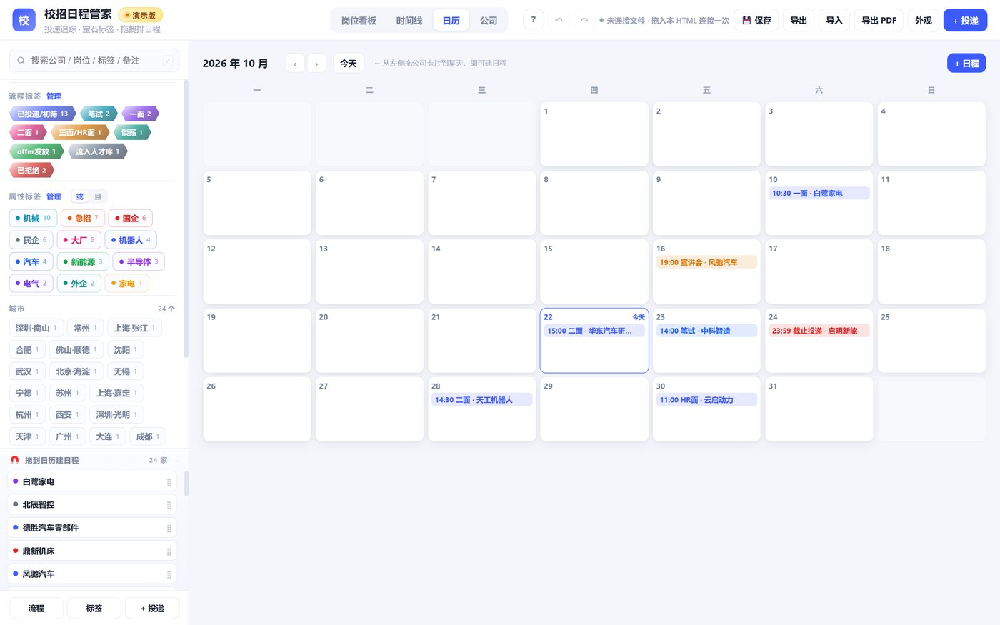
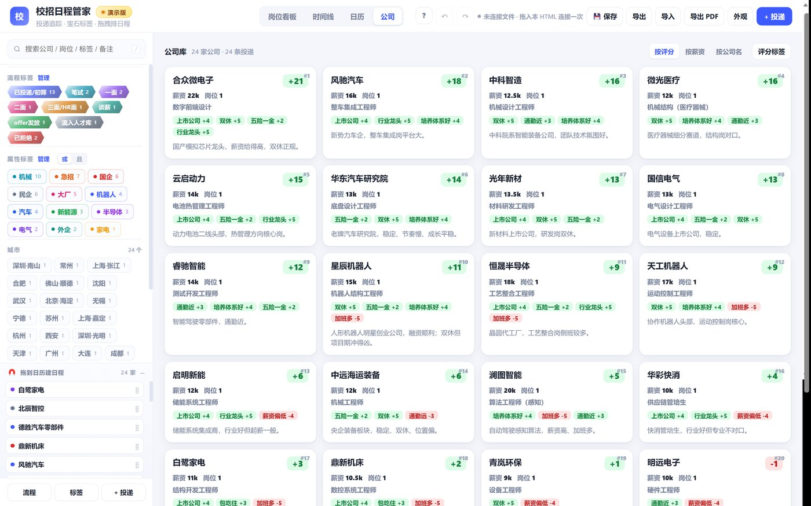
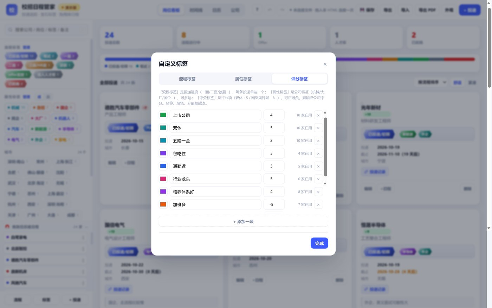
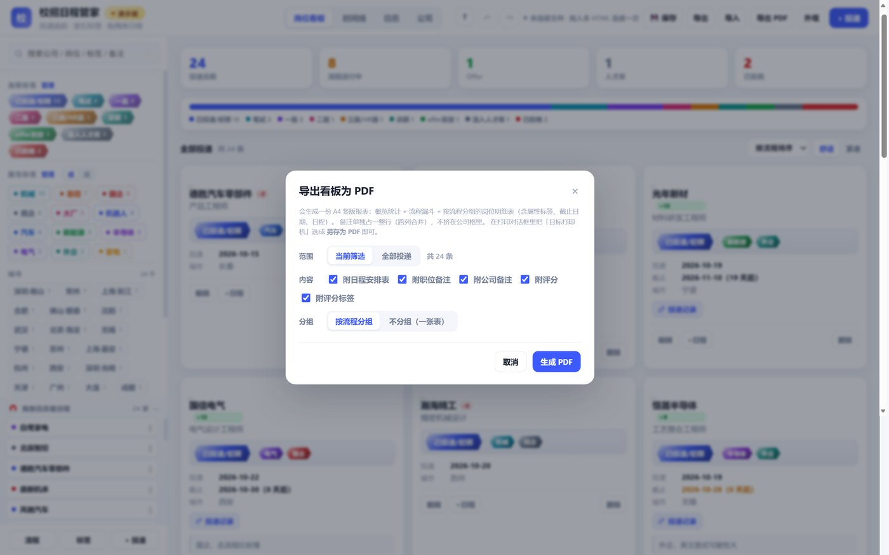
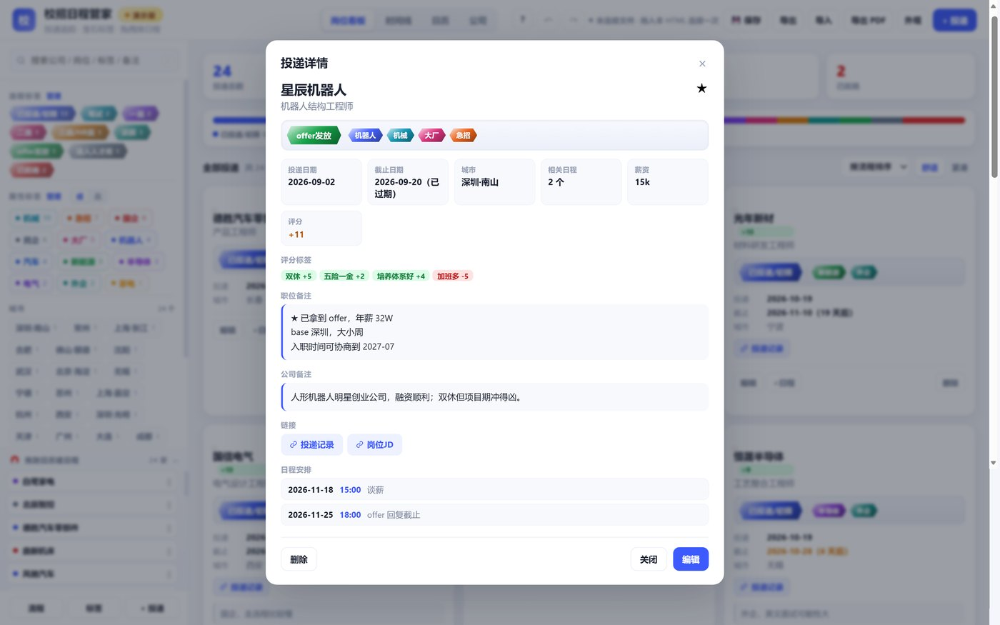
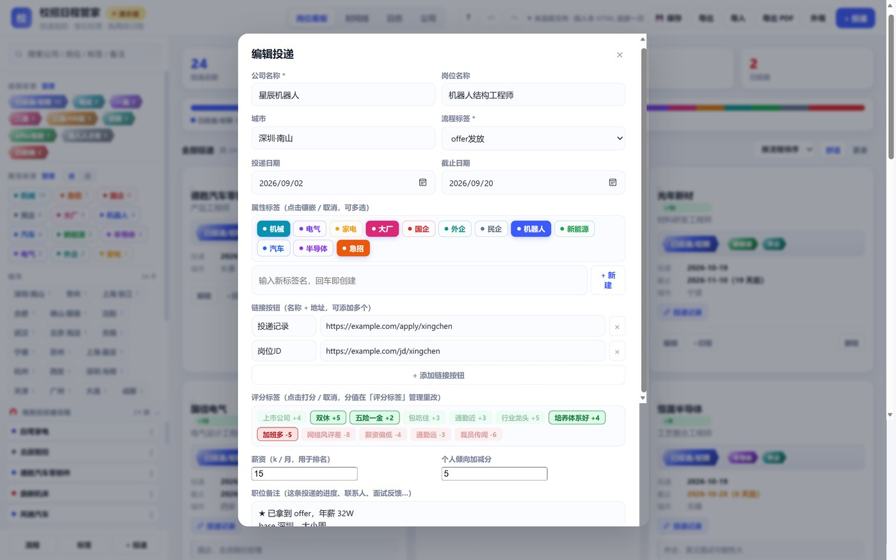
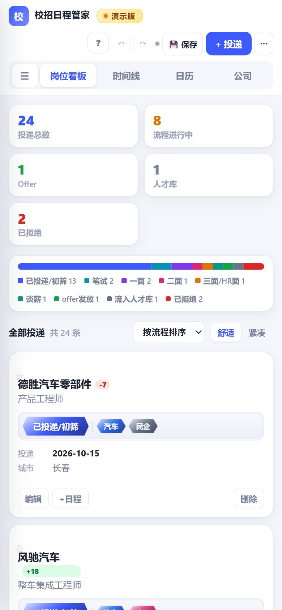

# 校招日程管家 · Campus Recruit Planner

（使用Deepseek Harness与Deepseek V4.1 Flash辅助完成，Markdown文档内容大部分也是鲸鱼生成的）

> 单文件、纯本地的校招投递追踪工具。把「投了哪些公司、走到哪一步、什么时候要做什么」三件事装进一个 HTML 页面，数据全部存在你自己的文件里。

一个 HTML 文件，双击就能用。不用注册、不用联网、不用装任何东西。你的投递记录、面试日程、公司风评全部存在这个 HTML 文件内部，想备份就复制文件，想分享就发文件。
（以下图片都是演示版，演示中的公司与实际无关，均为ai生成的虚拟公司）



---

## 目录

- [校招日程管家 · Campus Recruit Planner](#校招日程管家--campus-recruit-planner)
  - [目录](#目录)
  - [它解决什么问题](#它解决什么问题)
  - [快速开始](#快速开始)
    - [1. 下载并打开](#1-下载并打开)
    - [2. 连接文件（想让它自动保存时做一次）](#2-连接文件想让它自动保存时做一次)
    - [3. 日常操作](#3-日常操作)
  - [功能一览](#功能一览)
    - [四视图](#四视图)
    - [三层标签体系](#三层标签体系)
    - [评分系统](#评分系统)
    - [导出 PDF](#导出-pdf)
    - [导入与智能识别](#导入与智能识别)
    - [卡片预览](#卡片预览)
    - [卡片外观自定义](#卡片外观自定义)
    - [实时保存与撤销](#实时保存与撤销)
    - [移动端](#移动端)
  - [数据结构](#数据结构)
  - [技术实现](#技术实现)
    - [几个值得记下来的坑](#几个值得记下来的坑)
  - [常见问题](#常见问题)
  - [开发与测试](#开发与测试)
    - [目录结构](#目录结构)
  - [许可](#许可)

---

## 它解决什么问题

秋招投几十家公司是常态：有的在等笔试通知，有的约了二面，有的 offer 快到回复期限。信息散落在邮箱、聊天记录和各种招聘网站里，很容易漏掉关键节点。

这个工具把这堆东西收拢成一页：

- **一张卡片一家公司** —— 公司、岗位、城市、进度、截止日期、职位备注、公司备注、投递链接，全在一张卡上
- **一个日历装所有安排** —— 笔试、面试、宣讲会、offer 回复截止，月视图一眼看清哪周忙
- **一套标签做筛选** —— 按流程阶段、公司属性、城市、星标、临近截止随时收窄
- **一个分数帮你排序** —— 给公司打上「双休 +5」「网络风评差 −8」这类带分值的标签，自动算出这家公司值不值得去

---

## 快速开始

### 1. 下载并打开

下载 `campus-recruit-planner-demo.html`（或你自己导出的正式版），用 **Chrome / Edge 86+** 双击打开。

首次打开是演示数据（24 家虚构公司），可以直接拿来玩，也可以清空换成自己的。（似乎忘记做批量删除了，可以自己用agent做一个）

### 2. 连接文件（想让它自动保存时做一次）

保存**永远不会弹文件选择框**。要让改动写回文件，需要先连接一次：

1. 打开文件资源管理器，找到这个 HTML 文件本身
2. 把它**拖进浏览器页面**，页面出现全屏虚线高亮时松手
3. 浏览器顶部弹「允许写入」权限条时点**允许**
4. 之后所有改动都会自动覆盖写回这个文件，不用再操作

> 没连接也能正常用，改动会存在浏览器的恢复缓冲里不会丢，只是没写进磁盘。状态栏会一直提示「把本 HTML 拖到页面上即可连接」。
>
> 拖进来的必须是本工具自己的 HTML（里面要有 `id="APP_DATA"` 数据块）。拖错文件会提示「这个文件里没有数据块」。

### 3. 日常操作

| 想做什么 | 怎么做 |
| --- | --- |
| 加一家公司 | 右上角「+ 投递」 |
| 改信息 / 推进流程 | 点卡片打开预览，或点卡片上的「编辑」 |
| 排日程 | 进「日历」，把左下角公司卡片拖到某一天 |
| 删日程 | 日历上鼠标移到日程右侧出 `×`；或点开日程，底部红色删除 |
| 撤销 | `Ctrl+Z`（最多 80 步） |
| 重做 | `Ctrl+Shift+Z` 或 `Ctrl+Y` |
| 强制保存 | `Ctrl+S` |
| 导出报表 | 右上角「导出 PDF」 |

---

## 功能一览

### 四视图

| 视图 | 说明 |
| --- | --- |
| **岗位看板** | 投递卡片网格。可按流程 / 投递日期 / 截止日期 / 公司名 / 薪资 / 评分 / 星标排序，可切「舒适 / 紧凑」密度 |
| **时间线** | 投递 + 日程混合流，过期条目置灰，带「· 今天」「· 明天」相对标记 |
| **日历** | 月历网格，每天显示当日日程色条，`‹ ›` 翻月，「今天」回到当月 |
| **公司** | 按公司名聚合的排名卡片，可按评分 / 薪资 / 公司名排序 |





### 三层标签体系

| 类型 | 单选/多选 | 作用 | 外观 |
| --- | --- | --- | --- |
| **流程标签** | 单选 | 当前进度：已投递/初筛 → 笔试 → 一面 → 二面 → 三面/HR面 → 谈薪 → offer发放 → 流入人才库 → 已拒绝 | 宝石形状（`clip-path` 切角）+ 渐变底色 |
| **属性标签** | 多选 | 公司特征：机械 / 电气 / 家电 / 汽车 / 新能源 / 半导体 / 医疗器械 / 材料 / 软件 / 大厂 / 国企 / 外企 / 快消 / 机器人 | 圆形色点 + 名称，镶在卡片凹陷槽里 |
| **评分标签** | 多选 | 带正负分值的评价项：上市公司 +4 / 双休 +5 / 网络风评差 −8 / 裁员传闻 −6 | 胶囊 + 分值，正分绿底负分红底 |

三套标签都能在「管理」弹窗里增删、改名、改色（评分标签还能改分值）。

### 评分系统

每条投递的评分：

```
评分 = Σ(所选评分标签的分值) + 个人倾向加减分
```

- 编辑弹窗里点选评分标签、填薪资（k/月）、填个人倾向（可正可负，纯主观加权）
- 卡片上公司名右侧显示评分徽章：正分绿底、负分红底、0 灰底
- **公司页**把同一家公司的多条投递聚合起来：公司评分取**平均值**（避免投递多的公司无脑排前），薪资取**最大值**（反映这家公司的上限）
- 看板可按评分或薪资排序，公司页也能切三种排序



### 导出 PDF

点「导出 PDF」，可选：

- **范围** —— 当前筛选 / 全部投递
- **内容** —— 五个独立开关：☑ 日程安排表 ☑ 职位备注 ☑ 公司备注 ☑ 评分 ☑ 评分标签
- **分组** —— 按流程分组 / 不分组（一张表）

生成的是 A4 竖版报表：标题 + 导出时间、5 个统计卡、彩色漏斗条 + 图例、按阶段分组的明细表、日程汇总表、页脚。

明细表列按开关动态增减：`公司 / 岗位 / 城市 / 投递 / 截止 / 属性标签` 是固定列，之后按需插入 `评分`、`评分标签`、`日程`，列宽按开启的列数自动分配。

**备注独立成行**：备注不挤在公司单元格里（那样会把整行撑得很高），而是每条投递下面单独占一行、跨所有列合并。职位备注和公司备注各自一行，前缀不同颜色的标签，可以分别开关。



### 导入与智能识别

点「导入」选 JSON 备份 → 解析后弹出「自动识别标签」清单：

- 摘要条：「从 N 条投递里识别出 M 个标签（其中 K 个是新建的），应用后会有 X 条投递被打上标签」
- 每行 = 复选框 + 色点 + 标签名 +（新建时）琥珀色「新建」徽章 + 「N 条」
- 默认全选，可逐个取消，点「应用选中标签」或整批「跳过」

识别按公司名 / 岗位 / 城市 / 备注 / 流程名 / 已有标签名做子串匹配，命中 14 类关键词（机器人、机械、电气、家电、汽车、新能源、半导体、医疗器械、材料、软件、大厂、国企、外企、快消）。已存在的同名标签会复用，不会重复创建。

### 卡片预览

点卡片任意空白处（不是按钮）弹出「投递详情」：公司名、岗位、星标、流程 + 属性标签、投递/截止日期（过期标红、临近标橙）、城市、相关日程数、薪资、评分、评分标签及分值、链接按钮、完整职位备注、完整公司备注、相关日程列表。

底部三个按钮：删除 / 关闭 / 编辑。

卡片上的备注限制 3 行（手机 2 行）并加省略号，只有预览里才完整显示——这样长备注不会把卡片撑变形。





### 卡片外观自定义

`⋯` 菜单 →「外观」，7 行控件实时生效并随数据保存：

| 控件 | 范围 |
| --- | --- |
| 卡片宽度 | 210–460px |
| 内边距 | 8–26px |
| 圆角 | 0–26px |
| 边框粗细 | 0–4px |
| 公司名字号 | 11–22px |
| 卡片背景 / 边框颜色 | 任意色 + 「默认」 |
| 显示投影 / 悬停加深边框 | 勾选 |

底部有实时预览卡和「全部恢复默认」。拖动滑杆时实时生效，松手才提交撤销点，所以一次拖动只占一步撤销。

### 实时保存与撤销

- 任何改动后 **800ms 自动覆盖**写入已连接的文件，不弹任何对话框
- 未连接文件时写入浏览器恢复缓冲（localStorage），下次打开会问是否恢复
- 撤销栈最多 80 步，420ms 内的连续改动合并成一步
- `Ctrl+Z` 撤销 / `Ctrl+Shift+Z`、`Ctrl+Y` 重做 / `Ctrl+S` 强制保存

### 移动端

| 断点 | 行为 |
| --- | --- |
| > 1080px | 完整桌面布局，侧栏 272px |
| 861–1080px | 侧栏收窄 244px，统计卡 3 列 |
| 761–860px | 侧栏变抽屉（☰ 打开），顶栏单行紧凑，卡片 2–3 列 |
| ≤ 760px | 卡片单列，弹窗全宽 |
| ≤ 400px | 进一步缩小字号与内边距 |

顶栏 sticky 永远贴顶。`⋯` 收纳「导出 / 导入 / 导出 PDF / 外观」等次要操作。

移动端有两处行为差异：**保存改为一键下载**（不要求连接文件句柄）、**导出 PDF 走隐藏 iframe 打印**（移动浏览器直接 `window.print()` 常打出空白页），失败则降级下载一份可打印的独立 HTML。

<p align="center">
  
</p>

---

## 数据结构

数据内嵌在 HTML 的 `<script type="application/json" id="APP_DATA">` 块里，JSON 格式：

```json
{
  "v": 4,
  "stages": [{ "id": "st1", "name": "已投递/初筛", "color": "#3d5afe" }],
  "tags": [{ "id": "tg1", "name": "机械", "color": "#0e9f6e" }],
  "scoreTags": [{ "id": "sq01", "name": "双休", "color": "#0d9488", "score": 5 }],
  "apps": [{
    "id": "ap01",
    "company": "示例公司",
    "position": "机械助理工程师",
    "city": "北京",
    "stage": "st1",
    "tags": ["tg1"],
    "scores": ["sq01"],
    "salary": 13,
    "bias": 4,
    "applied": "2026-09-20",
    "deadline": "2026-10-30",
    "star": false,
    "note": "职位备注（进度、联系人、面试反馈）",
    "coNote": "公司备注（风评、通勤、福利）",
    "links": [{ "name": "投递记录", "url": "https://example.com" }]
  }],
  "schs": [{
    "id": "sc01",
    "title": "一面",
    "app": "ap01",
    "date": "2026-10-25",
    "time": "14:00",
    "type": "面试",
    "place": "线上",
    "note": ""
  }],
  "look": { "min": 292, "pad": 14, "radius": 14, "bd": 1, "co": 14.5,
            "bg": "#ffffff", "bdColor": "#e6e9f2", "shadow": true, "hover": true }
}
```

注意几个字段名容易踩坑：

- 日程关联投递的字段是 **`app`**，不是 `appId`
- `salary` 单位是 **k/月**（填 13 表示 13k）
- `bias` 是个人倾向加减分，可正可负
- 卡片外观存在 `look` 里

导出的 JSON 备份就是这个结构，可以直接编辑后重新导入。

---

## 技术实现

**没有构建步骤，没有依赖。** 一个 HTML 文件里包含全部 CSS、JS 和数据。

| 关注点 | 做法 |
| --- | --- |
| 数据持久化 | 数据内嵌在文件自身，保存时用 File System Access API 覆盖写回；降级方案是 localStorage 恢复缓冲 + 下载副本 |
| 文件连接 | 拖放 HTML 到页面，`DataTransferItem.getAsFileSystemHandle()` 拿句柄，句柄存 IndexedDB 跨会话复用 |
| 撤销重做 | 快照栈（`buildSnapshot()` 存整份 HTML），420ms 防抖合并，上限 80 步 |
| PDF 导出 | 不引第三方库。生成一份 `@media print` 专用的 DOM，交给浏览器打印，用户在打印对话框里选「另存为 PDF」 |
| 移动端打印 | 隐藏 iframe + `contentWindow.print()`，失败降级下载独立可打印 HTML |
| 样式主题 | CSS 变量（`--card-min` / `--card-bg` 等），外观设置直接改变量值 |

### 几个值得记下来的坑

**File System Access API 的 user activation 会被 `await` 消耗。** 点保存后如果先 `await h.queryPermission()`，再调 `h.createWritable()` 就会抛 `SecurityError: User activation is required to request permissions`。必须在点击手势内**同步**发出 `requestPermission()`，之后才能 await。

**`html,body{height:100%}` 会让 `position:sticky` 顶栏失效。** body 被固定成视口高度后，sticky 的约束框只有视口那么高，滚过一屏顶栏就跑了。改成 `html{height:100%}` + `body{min-height:100%}`。

**`flex-direction:column` 之后 `align-items:flex-start` 仍然生效。** 侧栏改成抽屉后，`.shell` 的 `align-items:flex-start` 让 `main` 收缩到内容宽度，卡片只能单列。要显式改 `align-items:stretch`。

**内嵌 JSON 里的 `</` 会提前结束 script 标签。** 写入时把 `</` 转成 `<\/`，读取时再还原。

**`afterprint` 事件会清空打印容器。** 调试打印版式时不能走完整的导出流程再截图，要手动塞内容 + `Emulation.setEmulatedMedia({media:'print'})`。

**两个 HTML 在同一台机器上共用 localStorage。** 演示版和正式版如果都用 `crp_` 前缀的键，打开演示版会读到正式版的真实数据。演示版必须换独立命名空间。

---

## 常见问题

**Q：数据存在哪？会不会上传到服务器？**
全在你的 HTML 文件里，不联网、不上传。想备份就复制文件，想换机器就拷文件。

**Q：为什么保存后没变化？**
检查状态栏。如果显示「未连接文件」，说明还没拖入 HTML 建立连接，改动只在浏览器缓冲里。

**Q：Firefox / Safari 能用吗？**
能打开、能正常使用和导入导出，但无法覆盖写回原文件（不支持 File System Access API），点保存会下载一份新副本。

**Q：演示版和正式版的数据会混在一起吗？**
不会。演示版用独立的存储命名空间（`crpd_` 前缀），两者互不影响。

**Q：能导入自己的数据吗？**
能。导出一份 JSON 备份看看结构，按同样的格式填自己的数据再导入即可，导入时还会自动识别标签。

**Q：手机上能用吗？**
能。手机浏览器打开后是单列布局，保存会下载一份新的 HTML（移动端拿不到文件写权限）。

---

## 开发与测试

项目只有一个 HTML 文件，改完直接在浏览器里刷新验证。自动化测试通过 Chrome DevTools Protocol 驱动 headless Edge：

```bash
# 启动 headless 浏览器
msedge --headless=new --disable-gpu --remote-debugging-port=9333 \
       --user-data-dir=/tmp/edge --no-first-run about:blank

# 新建标签页
curl -X PUT "http://127.0.0.1:9333/json/new?about:blank"
```

然后用 Python `websocket-client` 连接调试端口（需要 `suppress_origin=True`，否则 403），通过 `Runtime.evaluate` 执行断言、`Page.captureScreenshot` 截图、`Emulation.setDeviceMetricsOverride` 模拟移动端。

**踩坑**：同一个浏览器实例跑完一轮测试后第二轮常会 `WebSocketTimeoutException`，需要杀掉进程、删 profile、重启再跑。

更详细的数据结构、踩坑记录与测试历史见 [docs/DEVELOPMENT.md](docs/DEVELOPMENT.md)。

### 目录结构

```
.
├── campus-recruit-planner-demo.html   演示版（虚构数据，开箱即用）
├── README.md                          本文档
├── LICENSE                            MIT
└── docs/
    ├── DEVELOPMENT.md                 完整开发文档（数据结构、踩坑、测试历史）
    └── *.jpg                          README 配图
```

---

## 许可

MIT License。随便用、随便改、随便分发。
